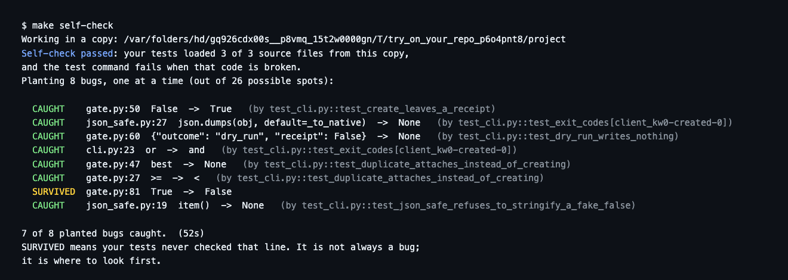

# verification-discipline

A runnable gate that proves its own tests can fail, and a command that checks whether yours can. For anyone running AI coding agents.



I run a fleet of coding agents that ship real work. They are capable and confident,
which is exactly what a wrong answer also looks like. So most of what I actually build
is the machinery that assumes the agents are lying until proven otherwise.

This repo is a small, honest sample of that machinery — enough to run, not the whole
fleet.

## Start here

- **[CASE_STUDY.md](CASE_STUDY.md)** — how I catch AI systems claiming they're done.
- **[gate-mutation-example/](gate-mutation-example/)** — runnable. `make test` then

  `make mutations`: a real gate, and proof its tests can actually fail.

- **[WHAT_THIS_DOES_NOT_PROVE.md](WHAT_THIS_DOES_NOT_PROVE.md)** — read this before you

  over-read the rest.

- **[mistakes-log-excerpt.md](mistakes-log-excerpt.md)** — six real failures, each with

  the countermeasure and the test that now catches it.

- **[andon](https://github.com/PrimeFoldTools/andon)** — the installable kit version of

  this discipline: defect ledger → countermeasure → mechanical guard, stripped from the
  system I run daily.

## The one-line version

My validation stack is built to reject flattering results, including my own. That
willingness — not any single green check — is the thing on offer.

## Runnable in 30 seconds

```
cd gate-mutation-example
python3 -m venv .venv && . .venv/bin/activate
pip install -r requirements.txt
make test        # 24 tests, offline, fake client
make mutations   # 4 seeded bugs, each caught, files restored byte-for-byte
```

Requires Python 3 and `pytest`. Nothing here touches a network or a private store.

## Try it on your own project

Can your tests fail? This plants small bugs, one at a time, in a copy of your project and runs your tests after each one. Your own files are never touched.

```
python3 gate-mutation-example/try_on_your_repo.py /path/to/your/project --test "python3 -m pytest -q -x"
```

First it runs a self-check: it adds one line to each source file in the copy that records the file's path when Python loads it, and checks which files your tests really loaded from the copy. Files they load from somewhere else (often an installed package) or never load are left out and named in the report, because bugs planted there would look like survivors. If no file loads from the copy, it stops instead of giving you a misleading report.

Just changed some code, or your agent did? Check only those lines:

```
python3 gate-mutation-example/try_on_your_repo.py /path/to/your/project --changed
```

`--changed` plants bugs only in lines changed since your last commit (or since any git ref: `--changed main`). Each CAUGHT line names the test that caught it, when pytest or unittest reports one.

Each bug is a flipped comparison, a swapped `True`/`False`, `and` turned into `or`, or a `return x` turned into `return None`. A CAUGHT line means your tests noticed. A SURVIVED line points at code your tests do not check. A BROKE line means the planted bug made the code fail to compile or import; that is a crash, not a test noticing, so it is not counted. On its own example project it caught 7 of 8; the one that survived (`gate.py:81`, a receipt flag no test asserts) is in the picture above.

It is a two-minute smoke check, not full mutation testing. For that, use [mutmut](https://github.com/boxed/mutmut). Python only, standard library only.

### Known limits

- SURVIVED means your tests never checked that line. It is not always a bug.
- It plants a small sample of bugs (`--max`, default 10). `--seed` makes a run repeatable. It is a smoke check, not a coverage score.
- Your tests must pass in a plain copy of the project. Tests that need a database, secrets or absolute paths will stop at the first run.
- Python only. It never edits your real files.

Related tools for full mutation testing: [mutmut](https://github.com/boxed/mutmut) and [cosmic-ray](https://github.com/sixty-north/cosmic-ray) (Python), [Stryker](https://github.com/stryker-mutator/stryker-js) (JavaScript), [PIT](https://github.com/hcoles/pitest) (Java).

## Licensing

Code (anything under `gate-mutation-example/`) is MIT — see [LICENSE](LICENSE).
Prose (the case study, the excerpts, this README) is not open-licensed — see
[LICENSE-CONTENT.md](LICENSE-CONTENT.md).

## Want this on your own setup?

- [Andon](https://github.com/PrimeFoldTools/andon): the installable version of this discipline for Claude Code and Codex.
- [primefold.tools](https://primefold.tools): what we build.
- Send us one incident: what your agent claimed, and what was true. The first three are free. primefoldtools@gmail.com
